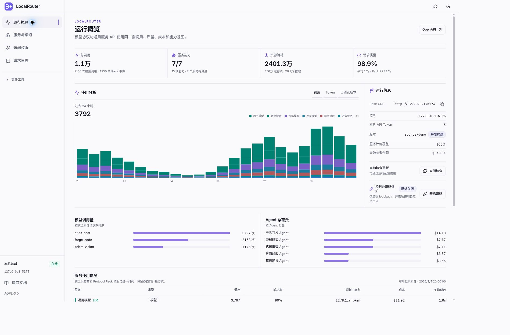
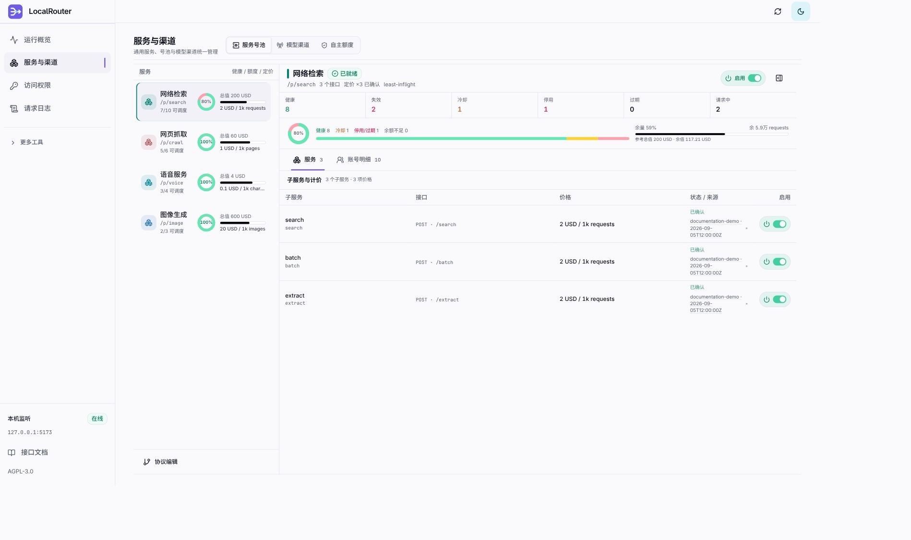
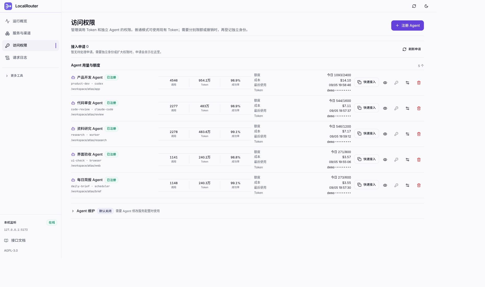

<div align="center">


# LocalRouter

**在自己的机器上，把模型 API、服务接口和 Agent 调用管起来。**

统一保存上游连接与密钥，为每个客户端分配调用身份，在一个控制台里查看用量、费用和账号池状态。

[](LICENSE)
[](CHANGELOG.md)


[安装](#安装与首次使用) · [首次接入](#配好第一个调用入口) · [控制台](#在控制台里管理服务) · [Agent](#让-agent-发现并调用服务) · [常见问题](#常见问题) · [文档](#开发与验证)

[下载发行版](https://github.com/vimalinx/LocalRouter/releases) · [变更记录](CHANGELOG.md) · [反馈问题](https://github.com/vimalinx/LocalRouter/issues)

</div>

<a href="docs/images/localrouter-overview.png">
  
</a>

本文截图由真实控制台渲染，服务、账号、用量和价格均为模拟数据。截图中的端口属于隔离演示，正常安装默认为 `8317`。[复现截图](docs/SCREENSHOTS.md)。

## 它解决什么问题

- **客户端少配一份上游信息。** 应用连接本机网关，供应商地址和密钥集中保存在 LocalRouter。
- **能看清每个 Agent 的使用情况。** 独立身份对应调用量、Token 用量、费用与请求额度。
- **服务能力可以先查询再调用。** Agent 从网关发现模型、操作和账号池，按各自的契约选择服务。

主程序由 Go 编写，内嵌 React 控制台，使用 SQLite 保存渠道、调用 Token 和模型请求日志，构建后以单个程序运行。

项目目前处于 **Alpha 阶段**。本文描述当前源码，安装发行包时以对应版本的[发布记录](https://github.com/vimalinx/LocalRouter/releases)为准。**新安装不含供应商账号，也没有可直接使用的供应商 Pack**，需要接入你有权使用的上游服务。

## 安装与首次使用

### 使用发行包

适用于 Linux，默认通过 systemd 用户服务运行。从 [Releases](https://github.com/vimalinx/LocalRouter/releases) 下载对应架构的压缩包，解压后在包内执行，无需安装 Go 或 Bun。

```bash
./tools/install-localrouter.sh install
```

安装完成后打开 [本机控制台](http://127.0.0.1:8317/)。默认仅本机免密访问；安装器会将程序和 `lr` 放入 `~/.local/bin`，并启动 `localrouter.service`。

```bash
systemctl --user status localrouter.service --no-pager
curl --fail http://127.0.0.1:8317/healthz
```

服务处于运行状态、健康检查返回成功后，即可配置上游。这一步只确认网关启动，还没有发起模型调用。

<details>
<summary>从源码安装</summary>

准备 Linux、Go 1.26 或更新版本、Bun、Git 和 Make。

```bash
git clone https://github.com/vimalinx/LocalRouter.git
cd LocalRouter
./tools/install-localrouter.sh install
```

安装器会构建前端和 Go 程序，安装位置与发行包相同。

</details>

仅安装、不启动可加 `--no-start`；自行管理进程时加 `--no-systemd`，随后运行 `localrouter`。`lr` 需要 Bash、curl 和 jq。安装也会写入带所有权标记的 Agent 指令与 Skill，具体位置见[安装器说明](docs/OPERATIONS.md#安装器对-agent-配置的改动)。容器用户可直接查看 [Docker 部署](docs/DOCKER.md)。

### 配好第一个调用入口

下面以已有的 OpenAI 兼容上游和一个同机聊天客户端为例。先准备上游文档给出的地址、可用模型 ID 和密钥。

**1. 添加模型渠道。** 打开“服务与渠道 → 模型渠道 → 添加渠道”，填写以下字段并保存。

| 界面字段 | 填写内容 |
|---|---|
| 渠道名称 | 自己能辨认的名称，例如“日常聊天” |
| 协议适配器 | 与上游相匹配的 OpenAI 兼容协议 |
| 上游基础地址 | 上游文档要求的基础地址，路径前缀与所选适配器保持一致 |
| 模型列表 | 上游实际可用的精确模型 ID，多个模型用英文逗号分隔 |
| 上游密钥 | 供应商签发的密钥；适配器明确无需密钥时可留空 |

保存后，渠道应出现在列表中并处于启用状态。确认实际计费后，可以使用“测试”检查连接；这会访问上游，可能消耗额度。

**2. 获取调用 Token。** 在“Token 管理”的“默认调用 Token”区域点击“复制 Token”，即可填入客户端的 API Key。需要独立限额或撤销时，进入“Token 管理 → 创建 Token”，填写唯一编码、名称、工作区和 Token 名称。建议为不同客户端分别创建 Token，便于单独限额或撤销；已有调用 Token 可以直接进入下一步。按需填写每日请求与并发上限，保持“维护专用 Token”未勾选，然后点击“创建并签发”。

新身份出现在列表后，把它的 Token 保存到客户端的凭据设置中。本文将 Service Token 统一称为**调用 Token**，控制台的“API Token”也指这类调用凭据。供应商密钥只填写在上游渠道中。

**3. 配置聊天客户端。** 在客户端选择 OpenAI 兼容连接，填写以下三项。

| 客户端字段 | 配置值 |
|---|---|
| Base URL | `http://127.0.0.1:8317/v1` |
| API Key | 上一步签发的调用 Token |
| Model | 渠道中已配置、上游实际可用的精确模型 ID |

这里的 Base URL 适用于标准模型渠道。完整 Protocol Pack 的地址从发现文档获取，符合聊天契约的 Pack 可用 `lr runtime-openai` 查询，见 [Agent 接入指南](docs/AGENT-USAGE.md#接入模型客户端)。

**4. 发一条消息并查看记录。** 确认计费后发送一次“请只回复 OK”。收到模型回复后，打开“请求日志”核对模型、渠道及耗时，再到“Token 管理”查看对应身份的调用量。调用失败时先看错误和日志，按[常见问题](#常见问题)排查。

## 在控制台里管理服务

### 服务与渠道

普通模型 API 从模型渠道接入。需要特殊鉴权、请求转换或异步任务时，使用 Protocol Pack 描述调用规则。

| 选择 | 适用情况 |
|---|---|
| 模型渠道 | 标准模型 API，配置上游地址、模型和密钥即可接入 |
| Protocol Pack | 独立服务路径、特殊认证、转换、专用账号池或工作流 |

<a href="docs/images/localrouter-services.png">
  
</a>

账号池在界面中也称“服务号池”。选中服务后可查看账号、额度、价格与操作，启用开关会影响调度。协议编辑使用草稿，发布前可以查看影响范围。

### Token 管理

<a href="docs/images/localrouter-agent-workbench.png">
  
</a>

每个 Agent 使用独立调用 Token，可分别设置速率、每日请求、并发和过期策略。启用请求限额后，计数会持久保存，重启不会清零；每日限额按 UTC 日期重置。

运行概览展示调用趋势、用量和已知成本，缺失价格会保留未知或部分计价状态。“任务与事件”查看工作流状态、结果及取消进度，“请求日志”查看模型调用明细。

## 支持哪些接入方式

| 需求 | 接入能力 |
|---|---|
| 模型 API | OpenAI 兼容接口、Anthropic Messages、Gemini 原生接口 |
| HTTP 与文件 | 自定义方法和路径、JSON 转换、multipart、二进制文件 |
| 流式与双向通信 | SSE、WebSocket、原始 gRPC 转发 |
| 长任务与特殊传输 | 持久工作流、回调与取消、固定回环地址的 adapter、受限 WASM adapter |
| 已有网关与账号池 | 保留外部网关的池所有权，或由 LocalRouter 调度本地凭据 |

实际可用操作由已配置的渠道与 Pack 决定。注册、登录授权、验证码和付款由用户或上游服务处理。传输、重试与工作流约束见 [Protocol Pack 参考](docs/PROTOCOL-PACK-V3.md)。

## 让 Agent 发现并调用服务

从发现服务开始，消费型 Agent 无需读取仓库文件。

```bash
lr status
lr tree
```

用 `lr find operation` 查操作、`lr find model` 查模型、`lr find pool` 查账号池。先明确选择服务，确认就绪状态和精确模型，再按公布的契约调用。付费或会改变上游状态的 Protocol Pack 操作需要授权及预检；预检失败时停止，已提交请求的结果不确定时先查状态。

[完整 Agent 指南](docs/AGENT-USAGE.md) 提供搜索、精确匹配、预检、单次请求与响应保存模板，以及长任务恢复和客户端配置。

## 控制台、调用和维护权限

| 使用者 | 凭据与权限 |
|---|---|
| 应用与消费型 Agent | 各自的调用 Token，用于调用服务 |
| 人工控制台 | 默认本机免密，可在运行概览开启密码保护 |
| 人工维护 MCP | 管理员凭据，始终需要鉴权 |
| 维护 Agent | 人工明确授予的独立维护 Token，默认关闭 |

调用 Token 与维护 Token 用途隔离。免密控制台不构成 Agent 修改配置的授权。完整密码规则、维护流程和安装器改动见[配置与权限说明](docs/OPERATIONS.md)。

## 让局域网设备调用

另一个设备需要使用本机的私有网络地址。启用独立 LAN 监听器后，默认通过端口 `8318` 提供受调用 Token 保护的服务接口；控制台与维护接口仍留在回环地址。

按[局域网配置](docs/OPERATIONS.md#让局域网设备调用)填写地址、来源与访问范围。远端 `lr` 需要操作者批准地址并设置 `LOCALROUTER_ALLOW_LAN=true`，在发送 Token 前会检查该入口只提供服务调用。

## 常见问题

**安装后为什么没有模型？**

安装只提供网关。先添加自己的上游渠道或 Pack，确认其启用状态、模型列表和凭据。截图里的服务均为演示内容。

**客户端的 Base URL 怎么填？**

同机标准 OpenAI 兼容渠道填 `http://127.0.0.1:8317/v1`，完整 Pack 使用其公布的地址。其他设备上的 `127.0.0.1` 指向那台设备自身，应改用已启用的 LAN 地址。客户端的 API Key 填调用 Token。

**调用失败去哪里看？**

先查看客户端错误，再检查“请求日志”或“任务与事件”。遇到 401/403 时确认凭据种类和权限，404 时检查入口与模型，429 时检查限额及账号池状态。请求结果不确定时先核对记录和上游状态，避免重复提交。控制台打不开时先运行 `systemctl --user status localrouter.service --no-pager`。

**为什么费用显示未知或部分计价？**

上游可能没有返回成本，或部分操作缺少可用价格。LocalRouter 会保留已知部分，未知不代表免费。详见[用量与成本说明](gateway/README.md#用量与成本边界)。

**更新和卸载会不会丢数据？**

安装器更新程序时保留已有配置，卸载也保留数据。默认配置、数据与状态分别位于 `~/.config/localrouter`、`~/.local/share/localrouter` 和 `~/.local/state/localrouter`，可用 `localrouter paths` 查看实际路径。更新前先备份，安装后重启服务；命令与迁移方法见[更新说明](docs/OPERATIONS.md#更新程序)。在源码或发行包目录执行 `./tools/install-localrouter.sh uninstall` 可卸载程序。

**终端提示找不到 `lr`？**

确认 `~/.local/bin` 已加入 `PATH`，也可以先用 `~/.local/bin/lr status` 验证。CLI 依赖 Bash、curl 和 jq；Token 文件的路径与权限配置见 [Agent 指南](docs/AGENT-USAGE.md#准备调用身份)。

## 开发与验证

准备 Go 1.26 或更新版本、Bun、Git 和 Make，在项目根目录执行。前端位于 `gateway/web-src`，构建到 `gateway/web` 后嵌入 Go 程序。

```bash
make build
./tests/verify.sh
```

本地测试使用隔离夹具，真实供应商调用需要另外授权与验证。贡献、分项检查和发行验收见下列文档。

| 文档 | 内容 |
|---|---|
| [Agent 使用](docs/AGENT-USAGE.md) | 发现、预检、调用、长任务与恢复 |
| [Agent 接入与恢复决策树](docs/AGENT-DECISION-FLOW.md) | 身份、审批生效、请求额度与未知任务恢复 |
| [Agent 预算与账单](docs/AGENT-BILLING.md) | 独立金额预算、消费明细、未知费用核对与撤销历史 |
| [配置与维护](docs/OPERATIONS.md) | 权限、安装副作用、更新、LAN、目录与迁移 |
| [网关参考](gateway/README.md) | 接口与用量计量 |
| [Protocol Pack v3](docs/PROTOCOL-PACK-V3.md) · [架构](docs/PROTOCOL-ARCHITECTURE.md) | 协议、传输、账号池和扩展方式 |
| [Docker 部署](docs/DOCKER.md) | 容器与局域网使用 |
| [参与开发](CONTRIBUTING.md) · [开源发行](docs/OPEN_SOURCE_RELEASE.md) | 测试、贡献与发行流程 |
| [报告安全问题](SECURITY.md) | 安全问题反馈渠道 |

## 项目来源与许可证

早期版本参考并复用了 QuantumNous New API。当前运行时不再依赖其源码或 Go 模块，保留开发历史与归属说明，不作 clean-room 重写声明。详见 [PROVENANCE.md](PROVENANCE.md)。

LocalRouter 使用 [AGPL-3.0](LICENSE) 许可证。依赖许可证见 [THIRD-PARTY-LICENSES.md](THIRD-PARTY-LICENSES.md)，其他归属信息见 [NOTICE](NOTICE)。
