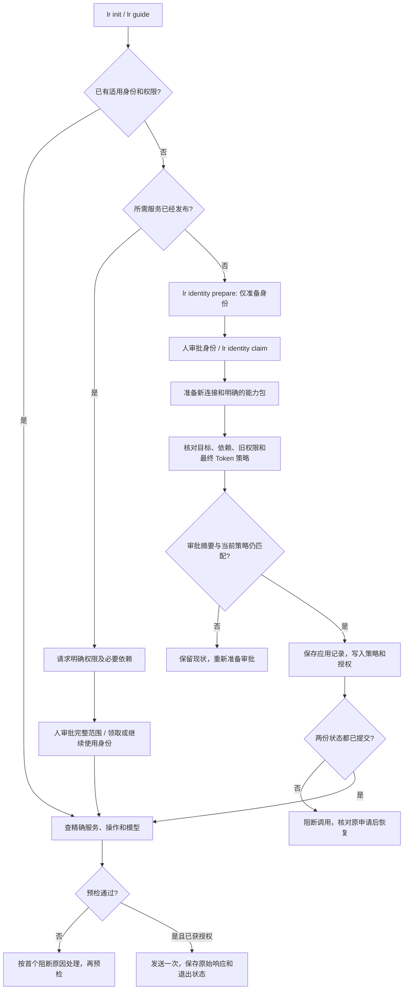
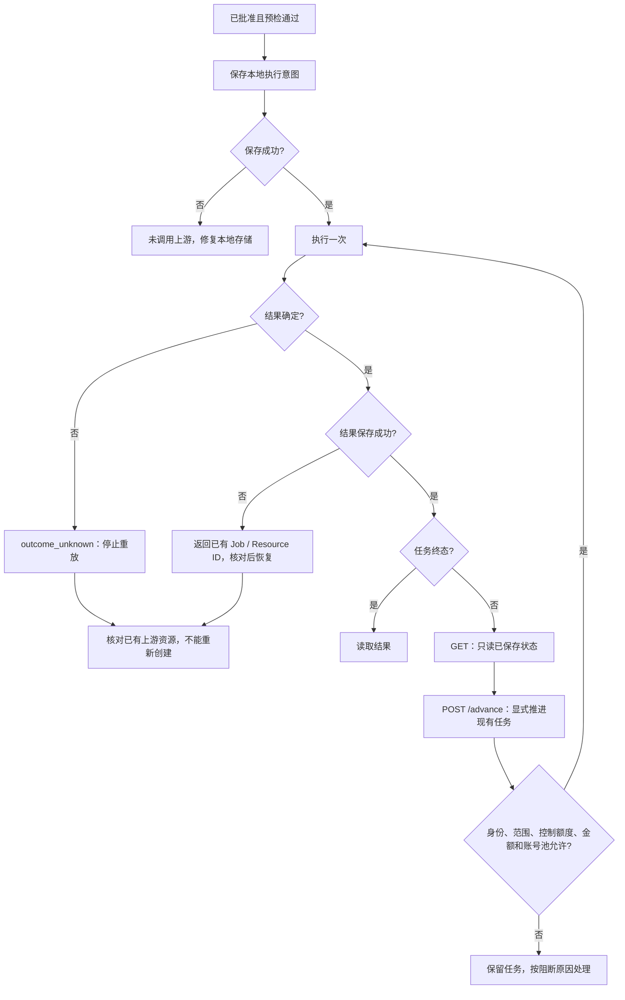

# Agent 接入、授权与任务恢复

契约版本 **15**。普通模式继续接受已有 Service Token；独立身份用于分别授权、计费和准备新服务。以下流程通过隔离网关与本机上游模拟测试，不能代替真实供应商验收。

## 接入决策树

- `setup_only=true` 是明确的禁止调用状态，不能用空白策略代替。它不依赖任何已发布服务；仍须人批准身份。
- 审批展示模型目录、工作流操作及恢复入口等必要依赖。兼容接口的精确选择器由发现文档发布，并由实际路由使用同一映射校验。
- 新连接审批会保存完整前后策略，保留金额、模型、次数、并发和有效期限制。第一次增加能力包时，原来可用的服务会作为单独的已审阅快照保留。替换已有能力包须显式提交 `bundle` 方案。
- 并发修改策略后，旧申请不得覆盖新策略。应用记录未完成时拒绝调用；恢复只接受原策略或已审阅的目标策略，不重复安装或调用供应商。无法继续的中断申请可由人在控制台“撤销未完成授权”：只有仍等于这次写入的策略才恢复为原策略；后续人工编辑、已安装服务和上游任务均保留。
- 机器契约同时发布调用身份与仅准备身份；`identity_scope_unpublished` 明确给出取消旧申请、申请仅准备身份、人工批准和领取的恢复路径。`lr identity schema` 与 `lr setup schema [proposal|pack]` 均只依赖当前端口。
- 旧提案使用 `lr setup reprepare <id> <digest> [--enable]` 或控制台生成新的待审阅方案。保留旧记录和关联，重新计算权限，不继承批准或重复调用；禁用连接必须明确请求启用。
- 无效身份申请可用 `lr identity cancel` 清理，服务端会撤销对应领取凭据，防止延迟到达的请求重新创建申请。已批准身份必须撤销身份，不能伪装成“取消待申请”。

## 调用与恢复决策树

- GET `/w/<pack>/<workflow>/<job>` 不再推进任务。POST 同一路径的 `/advance` 才允许推进；`lr watch` 已更新为该协议。旧客户端必须更新，不能继续依赖 GET 触发轮询。
- 声明的模型目录、任务本地读取和既有任务恢复使用每 Token 每分钟 120 次控制额度，不扣业务请求次数。恢复操作仍受金额、共享额度、并发、账号池和当前权限限制。新的写入步骤继续扣业务次数。
- HTTP 层的结果未知会传播到串行和并行工作流；任一分支结果未知，都不得通过普通 5xx 转移重新执行整组请求。
- 创建任务前先持久化意图。进程中断后的执行记录进入 `outcome_unknown`；创建已成功但结果保存失败时保留响应中的 Job/Resource ID。`lr run` 和 `lr exec` 都会保存一次原始响应，`lr result` 可查。
- `lr watch` 遇到 `outcome_unknown` 立即非零退出。服务端不会把不确定的成功包装成成功；需要核对供应商状态，或显式执行已声明的取消操作。

## 回归覆盖

`gateway/decision_tree_regression_test.go` 覆盖 A01–A12：首次服务身份循环、审批后权限冲突、模型依赖、准备消耗业务额度、工作流范围、标准兼容接口范围、无效申请恢复、额度耗尽后任务恢复、未知任务退出、金额预检指引、工作流重复写入、创建前持久化。

额外覆盖：策略修改冲突、部分授权提交后的阻断与恢复、授权文件写入失败、创建成功后的结果落盘失败、控制额度上限与撤销、并行未知结果和图工作流的只读恢复。浏览器验收检查审批前的完整有效权限展示。
